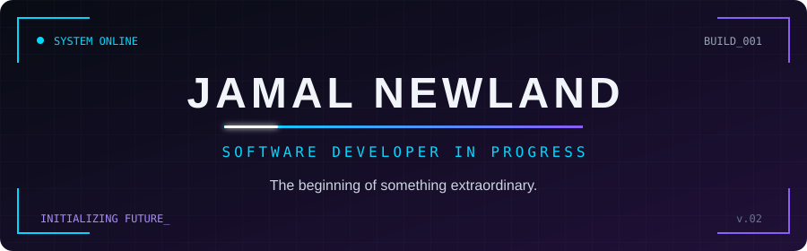
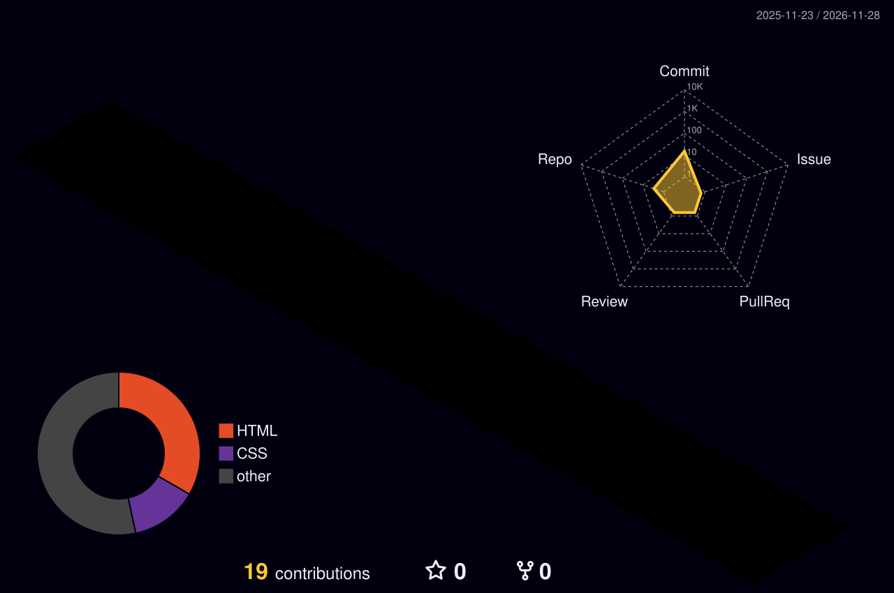

  

## About Me

I am a Software Development student with a passion for technology, problem-solving, and continuous learning.

Currently building my foundation in web development and programming, with the ambition to create meaningful and innovative software.

**Learn. Build. Improve. Repeat.**

## Tech Stack

## Current Focus

- Improving my HTML, CSS and JavaScript skills.
- Learning PHP and backend development.
- Building practical web applications.
- Improving my Git and GitHub workflow.
- Developing clean and maintainable code.

## Current Project

### Bank of the Future

A web-based banking application built with HTML, CSS and JavaScript.

- User authentication
- Account balance overview
- Money transfers
- Clear transaction feedback

**Status:** In Development

## GitHub Statistics

## 3D Contribution Skyline

  

